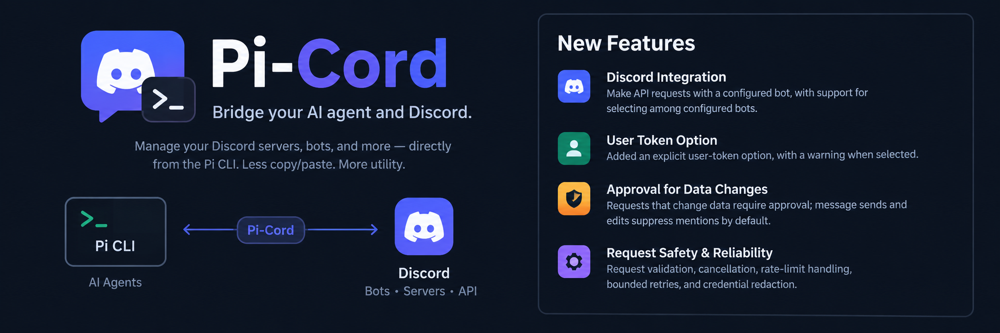

# Pi-Cord

**Connect your Pi AI agent to Discord.**

Read conversations, summarize feedback, and draft replies from [Pi](https://pi.dev).
You review and approve each request that changes data before it reaches Discord.

Pi-Cord is a Pi extension. It uses Discord's API directly, so you do not need to
run a separate bot service or keep a background connection open.

[Get started](#get-started) · [Examples](#try-it) · [Technical guide](docs/technical-guide.md) · [Security](SECURITY.md)

## What you can do

- **Catch up on conversations:** ask for a channel recap or a summary of recent feedback.
- **Prepare replies:** draft a message, review it, and approve sending it.
- **Work across servers:** use one bot or choose among several configured bots.
- **Stay in control:** approve changes individually, with the account and request details shown first.

What Pi-Cord can access depends on your bot's Discord permissions. It does not
grant access to private channels or server features your bot cannot use.

## Get started

You need **Node.js 22.19 or later**, **Pi**, and permission to add a bot to your
Discord server. A bot is a Discord account created for tools and integrations.

### 1. Install Pi-Cord

Run this command in your terminal:

```sh
pi install git:github.com/DysektAI/pi-cord
```

If you used the Discord extension from `pi-extensions`, follow the
[migration instructions](docs/technical-guide.md#migration) to avoid loading it twice.

### 2. Set up a Discord bot

1. Open the [Discord Developer Portal](https://discord.com/developers/applications) and create an application.
2. Open its **Bot** settings and create or retrieve the bot token. Treat this token like a password.
3. Use the application's installation settings to invite the bot to your server.
4. Give it **View Channel** and **Read Message History** in the channels you want it to read.
   Add **Send Messages** if you want to send replies.

Reading ordinary server message content may also require enabling **Message Content Intent**
in the portal's Bot settings. Grant only the permissions you need.

### 3. Connect the bot to Pi

Set `DISCORD_BOT_TOKEN` in the terminal where you will start Pi. Use the example
for your shell, replacing `YOUR_BOT_TOKEN` with your bot's token.

**Windows PowerShell**

```powershell
$env:DISCORD_BOT_TOKEN = 'YOUR_BOT_TOKEN'
pi
```

**macOS / Linux (Bash or Zsh)**

```sh
export DISCORD_BOT_TOKEN='YOUR_BOT_TOKEN'
pi
```

These settings apply to the current terminal session. For ongoing use, supply the
token through your private environment or secret manager. Never paste a token
into a Pi conversation, commit it to Git, or put it in shared settings.
Terminal commands may be saved in your shell history; use your secret manager
if you need to avoid entering the token there.

## Try it

Give Pi a channel ID and ask in plain language:

> Summarize the recent messages in Discord channel CHANNEL_ID. Highlight questions that need a reply.

> Read the latest feedback in channel CHANNEL_ID and group it by topic.

> Draft a reply thanking everyone for their feedback. Show me the draft before sending it to channel CHANNEL_ID.

To find a channel ID, enable **Developer Mode** in Discord's settings, then
right-click the channel (or open its context menu) and choose **Copy Channel ID**.
Replace `CHANNEL_ID` in the examples with that number.

For a time-based recap, ask Pi to check earlier message pages as needed. One page
may not cover the full period, and summaries should identify missing content or
incomplete coverage.

## How approval works

Reading messages does not require confirmation. Every request that changes data
requires approval in Pi, including sending, editing, or deleting a message.
The confirmation shows the account, action, API path, and full prepared message or data.
Declining sends nothing. Each approval covers one request.

An interactive Pi interface is required for approval. Without a compatible
confirmation interface, reads can work, but changes are blocked.

Standard channel-message sends and edits, plus supported webhook message routes,
suppress automatic mentions by default. Other message-producing routes may behave
differently; review their mention settings before approving them.

Pi-Cord also limits request duration and response size, handles rate limits,
supports cancellation, and redacts configured credentials from response and error text.
See the [request safeguards](docs/technical-guide.md#request-safeguards) for limits and exceptions.

## Common questions

**Can I use more than one bot?**

Yes. Add named environment variables such as `DISCORD_BOT_TOKEN_WORK`, or use a
private `discord.json` file. See [bot configuration](docs/technical-guide.md#supported-setup-bot-accounts)
for account selection, aliases, and defaults.

**Why are messages missing or empty?**

Check the bot's channel permissions and Message Content Intent setting. A summary
can also be incomplete if Pi has read only part of the message history.

**Why can't Pi send a message?**

Check **Send Messages** permission and use a Pi interface that can display approval
prompts. Reads can succeed even when changes are blocked.

**Can I use my personal Discord account?**

Use a bot account for the supported setup. The retained user-token mode is
unsupported and risks account termination. Read the
[user-token warning](docs/technical-guide.md#unsupported-user-token-mode-and-acceptable-use)
before considering it. It is never selected automatically.

## Technical details and contributing

The [technical guide](docs/technical-guide.md) covers:

- The `discord` tool's API parameters and request examples.
- Multiple bots, credential files, and account selection.
- Request limits, retries, cancellation, and mention defaults.
- Host dependency security, migration, and local development checks.

Pi supplies the SDK dependencies. Installing Pi-Cord does **not** patch your Pi
installation or its bundled dependencies; maintainers should review the
[host security notes](docs/technical-guide.md#host-dependency-security).

For security limitations and reporting, see [SECURITY.md](SECURITY.md).
For bugs and suggestions, [open an issue](https://github.com/DysektAI/pi-cord/issues).

## License and acknowledgments

[MIT](LICENSE). Independent project; not affiliated with or endorsed by Discord.
Originally extracted from [DysektAI/pi-extensions](https://github.com/DysektAI/pi-extensions).
